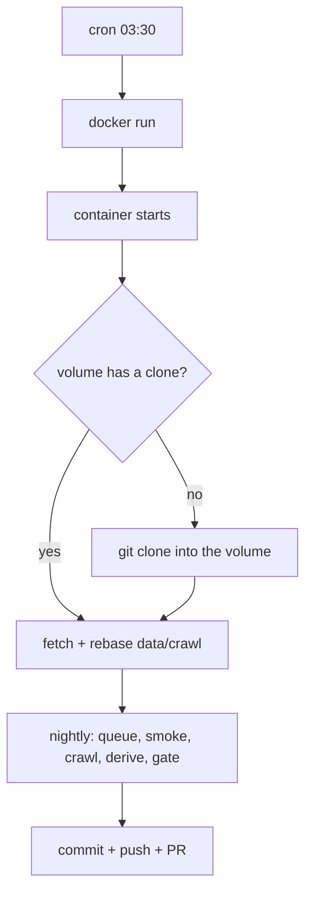

# Nightly crawl

One unattended run: read the request queue from Turso, check that Coursera still
parses, crawl, rebuild the derived data, then commit on a bot branch and keep a
pull request open against `develop`. Production is untouched until you merge.

**Everything happens inside the container.** The clone, the page cache, the logs
and the commits live in a volume the container owns. The host supplies three
things and nothing else: the image, `/etc/starisk/env`, and a cron line. The repo
is only the build context — it is never mounted, checked out or executed. There is
no checkout to switch, no cache to keep and no branch to clean up on the host.



## Try it locally

Same image, same behaviour — only the trigger differs. The first run clones into
the volume, which takes a minute; after that it is incremental.

```sh
# Config, connectivity and the live pages. Writes nothing, needs no .env.
ops/run.sh --dry-run

# The whole pipeline, no commit, no push.
ops/run.sh --no-git --limit 1

# Throw the clone away and start over.
docker compose -f ops/compose.yml down -v
```

Your working copy is never mounted, so none of this touches it.

## Deploy

The repo is the build context and nothing more — it is never mounted, checked out
or executed by the schedule.

```sh
# 1. Somewhere to build from. A clone in your home is fine.
git clone -b develop https://github.com/MatiasAgelvis/starisk.git ~/src/starisk
cd ~/src/starisk

# 2. The secrets.
cp ops/.env.example ops/.env
$EDITOR ops/.env          # Turso, GitHub token, ntfy topic

# 3. One command: build the image, install /etc/starisk/env at 600, and replace
#    only its own cron line. --check also runs a dry run at the end.
sudo ./ops/setup.sh --check
```

That leaves three things on the host — the image, `/etc/starisk/env`, one cron
line — and no compose file. The line it installs:

```cron
30 3 * * * docker run --rm --env-file /etc/starisk/env -v starisk:/srv/starisk starisk-nightly 2>&1 | logger -t starisk-nightly # starisk-nightly
```

Root is there for the Docker socket, nothing else: it runs that fixed command,
the env file is root-owned `600`, and the image is immutable.

Output goes to the journal, which already rotates: `journalctl -t starisk-nightly`.
The pipe hands the exit status to `logger`, so cron never sees a failure — that is
fine, `last-run.json` is the signal. If the box has no `logger`, redirect to a file
and add a logrotate entry for it instead.

`logs/last-run.json` lives in the volume:

```sh
docker run --rm -v starisk:/srv/starisk --entrypoint cat \
  starisk-nightly /srv/starisk/logs/last-run.json
```

Cron does not catch up a run missed while the box was off, and it does not need
to: the crawl is staleness-based, so the next run picks up whatever was skipped.

## Day to day

- **The pull request.** `Nightly crawl`, from `data/crawl` into `develop`. It is
  updated (not recreated) every night and its body carries that run's counts.
  Merge it whenever; the next night starts a new one. **Merge or fast-forward it —
  never squash**, and don't use GitHub's "Update branch" button: both rewrite the
  commits in a way the next rebase cannot reconcile.
- **ntfy.** Silent when nothing changed, a digest when something did, high
  priority on failure. `last-run.json` is written in the silent case too, so a
  dead cron looks different from a quiet week.
- **Updating the job.** Merge to `develop`; the next run fetches and rebases onto
  it before starting Python, so the code that runs is the code just fetched.
  Rebuild the image only when the entrypoint or runtimes change: `sudo ./ops/setup.sh`
  (it rebuilds), or `docker build -f ops/Dockerfile -t starisk-nightly .`.

## Exit codes

| Code | Status | What it means |
|---|---|---|
| 0 | ok | Committed (or dry run passed) |
| 10 | nothing | Ran, changed nothing, no commit, no notification |
| 20 | refused | A gate tripped; read `reason` in `last-run.json` |
| 30 | partial | Committed, but Coursera rate-limited the crawl |
| 40 | git | A rebase conflict or a failed push |
| 50 | smoke | A live page stopped parsing — nothing was crawled |
| 60 | config | A required variable is missing |
| 70 | failed | Anything unexpected |

## Flags

```sh
nightly                       # the real run
nightly --dry-run             # config + smoke only, writes nothing
nightly --no-git              # the pipeline, no commit and no push
nightly --limit 20            # smaller valve for one night
nightly --limit 0             # uncapped
nightly --no-push             # commit on the branch, stop before push/PR
nightly --offline             # re-parse the cache, no requests
nightly --env-file .env.prod  # host runs: read a dotenv instead of exporting it
```

The container gets its environment from `--env-file` — `/etc/starisk/env` on the
box, `ops/.env` for the local compose path — so `--env-file` is for running the
module directly on the host:

```sh
mise run pipeline:nightly -- --env-file .env.prod --dry-run
```

## First run on a fresh volume

The volume starts empty, so the entrypoint clones `develop`, then
`starisk.checkout` switches to `data/crawl` and rebases it onto `origin/develop`.
The page cache is empty too, so the run fetches the program pages the index needs
back before rebuilding it — roughly 25 requests, once. Later nights make none.

## When something goes wrong

**`40 git`** — the rebase of `data/crawl` onto `develop` conflicted, or the push
was rejected. The branch is left as it was. Reproduce inside the volume:

```sh
docker run --rm -it -v starisk:/srv/starisk --entrypoint sh starisk-nightly
```

**`20 refused`** — the run produced something it did not trust: courses
disappeared, the scored count dropped by more than five, three or more records
gained errors, or a file outside `pipeline/data` and `web/src/data` changed. The
refused data is left uncommitted in the volume for inspection.

**`50 smoke`** — a Coursera page stopped parsing. Each run checks a normal
course, a low-sample course, and a program page before crawling, so this fires
early instead of after an hour of cache writes. Reproduce with:

```sh
cd pipeline && STARISK_LIVE=1 python3 -m unittest tests.test_live
```

**`30 partial`** — Coursera rate-limited us partway through. The commit is
valid, the next run resumes at the stalest course.

**Login prompt / `could not read Username`** — `GITHUB_TOKEN` is missing or
expired. The token is read from the environment at push time and is never written
to the clone's `.git/config`.
