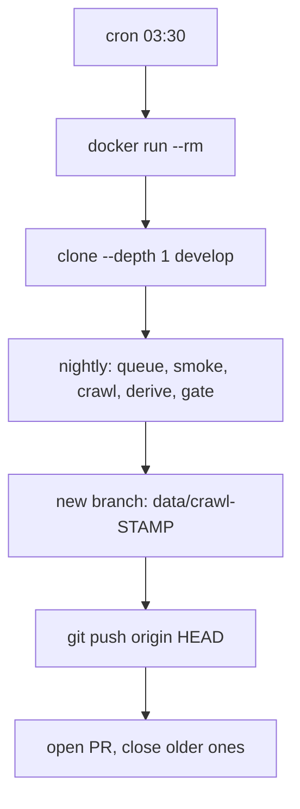

# Nightly crawl

One unattended run: read the request queue from Turso, check that Coursera still
parses, crawl, rebuild the derived data, then publish a branch and open a pull
request against `develop`. Production is untouched until you merge.

**The container is stateless.** Every run clones `develop` into its own
filesystem, does the work, publishes, and exits; the clone dies with the
container. Only one volume survives: `starisk-state`, holding the JSON corpus and
the page cache. The host supplies three things and nothing else: the image,
`/etc/starisk/env`, and a cron line.



The push is a **create**: the branch is named after the run, so the ref is new
and git has no non-fast-forward case to refuse. No rebase, no `--force`, no lease,
and nothing that depends on what happened to last night's branch. Merging,
squashing or deleting it afterwards changes nothing for the next run.

State is `pipeline/data` by default and the volume wherever `STARISK_DATA` points;
the run record and the lock follow `STARISK_LOGS`. The corpus is cumulative, so the
newest branch always carries everything.

## Try it locally

Same image, same behaviour — only the trigger differs.

```sh
# Config, connectivity and the live pages. Writes nothing, needs no .env.
ops/run.sh --dry-run

# The whole pipeline, no commit, no push.
ops/run.sh --no-git --limit 1

# Throw the accumulated corpus away and start from an empty state.
docker compose -f ops/compose.yml down -v
```

Your working copy is never mounted, so none of this touches it.

## Deploy

```sh
# 1. Somewhere to build from. A clone in your home is fine.
git clone -b develop https://github.com/MatiasAgelvis/starisk.git ~/src/starisk
cd ~/src/starisk

# 2. The secrets. Any path works; --env takes it relative to the repo or absolute.
sudo ./ops/setup.sh --env .env --check
```

That leaves four things on the host — the image, the `starisk-state` volume,
`/etc/starisk/env`, one cron line — and no compose file. The line it installs:

```cron
30 3 * * * docker run --rm --init --env-file /etc/starisk/env -v starisk-state:/state starisk-nightly 2>&1 | logger -t starisk-nightly # starisk-nightly
```

`STARISK_DATA=/state` and `STARISK_LOGS=/state/logs` come from the image, so the
cron line does not repeat them.

Root is there for the Docker socket, nothing else: it runs that fixed command,
the env file is root-owned `600`, and the image is immutable.

Output goes to the journal, which already rotates: `journalctl -t starisk-nightly`.
The pipe hands the exit status to `logger`, so cron never sees a failure — that is
fine, `last-run.json` is the signal. If the box has no `logger`, redirect to a file
and add a logrotate entry for it instead.

`logs/last-run.json` lives in the state volume:

```sh
docker run --rm -v starisk-state:/state --entrypoint cat \
  starisk-nightly /state/logs/last-run.json
```

Cron does not catch up a run missed while the box was off, and it does not need
to: the crawl is staleness-based, so the next run picks up whatever was skipped.
A night with no run is a night with no push, and the next push carries the whole
snapshot anyway.

## Day to day

- **The pull request.** `Nightly crawl`, from `data/crawl-<stamp>` into `develop`.
  One per run; the bot closes the previous one and deletes its branch, so there is
  ever one open. Merge it however you like — squash included — and delete the
  branch. Nothing depends on it afterwards.
- **ntfy.** Silent when nothing changed, a digest when something did, high
  priority on failure. `last-run.json` is written in the silent case too, so a
  dead cron looks different from a quiet week.
- **Updating the job.** Merge to `develop`. The next run clones it, so the code
  that runs is the code you merged. Rebuild the image only when the entrypoint or
  runtimes change: `sudo ./ops/setup.sh --env .env`, or
  `docker build -f ops/Dockerfile -t starisk-nightly .`.

## Exit codes

| Code | Status | What it means |
|---|---|---|
| 0 | ok | Committed and published (or dry run passed) |
| 10 | nothing | Ran, changed nothing, no commit, no notification |
| 20 | refused | A gate tripped; read `reason` in `last-run.json` |
| 30 | partial | Published late: either Coursera rate-limited the crawl, or the push failed. The data is in the state volume; the next run publishes it |
| 40 | git | Clone, commit or push failed — the message names which |
| 50 | smoke | A live page stopped parsing — nothing was crawled |
| 60 | config | A required variable is missing |
| 70 | failed | Anything unexpected |

## Flags

```sh
nightly                       # the real run
nightly --dry-run             # config + smoke only, writes nothing
nightly --no-git              # the pipeline, no commit and no push
nightly --limit 20            # smaller valve for one night
nightly --limit 0             # uncapped
nightly --no-push             # commit on the branch, stop before push/PR
nightly --offline             # re-parse the cache, no requests
nightly --env-file .env         # host runs: read a dotenv instead of exporting it
```

The container gets its environment from `--env-file` — `/etc/starisk/env` on the
box, `ops/.env` for the local compose path — so `--env-file` is for running the
module directly on the host:

```sh
mise run pipeline:nightly -- --env-file .env --dry-run
```

## First run on a fresh volume

The entrypoint seeds the state volume from the clone when `/state/sources.json` is
missing, so a fresh volume adopts the corpus committed to `develop` and the crawl
starts from there instead of from nothing. The page cache is not in git, so the
program index rebuilds by fetching the pages it needs — roughly 25 requests, once.

## When something goes wrong

**`40 git`** — the clone, the commit or the push failed in a way that left nothing
published. There is no rebase and no force, so there is nothing half-applied to
repair. The crawl's data is in the state volume either way.

**`20 refused`** — the run produced something it did not trust: courses
disappeared, the scored count dropped by more than five, three or more records
gained errors, or a file outside `pipeline/data` and `web/src/data` changed. The
refused data stays in the state volume for inspection.

**`50 smoke`** — a Coursera page stopped parsing. Each run checks a normal
course, a low-sample course, and a program page before crawling, so this fires
early instead of after an hour of cache writes. Reproduce with:

```sh
cd pipeline && STARISK_LIVE=1 python3 -m unittest tests.test_live
```

**`30 partial`** — Coursera rate-limited us partway through, or the push failed.
Either way the data is in the state volume and the next run carries it forward:
the corpus is cumulative, so nothing is lost by publishing a night late.

**Login prompt / `could not read Username`** — `GITHUB_TOKEN` is missing or
expired. The token is read from the environment at push time and is never written
to the clone's `.git/config`.

## Migrating from the volume-clone layout

The old job kept a clone in the `starisk` volume and rebased `data/crawl` every
night. Nothing in it is reused: delete the volume and the branch.

```sh
docker volume rm starisk
git push origin --delete data/crawl     # if it still exists
```

Nothing has to be carried over by hand: the entrypoint seeds the new volume from
the clone on its first run. The page cache is not in git, so the first crawl after
the switch is slower than the ones that follow.
